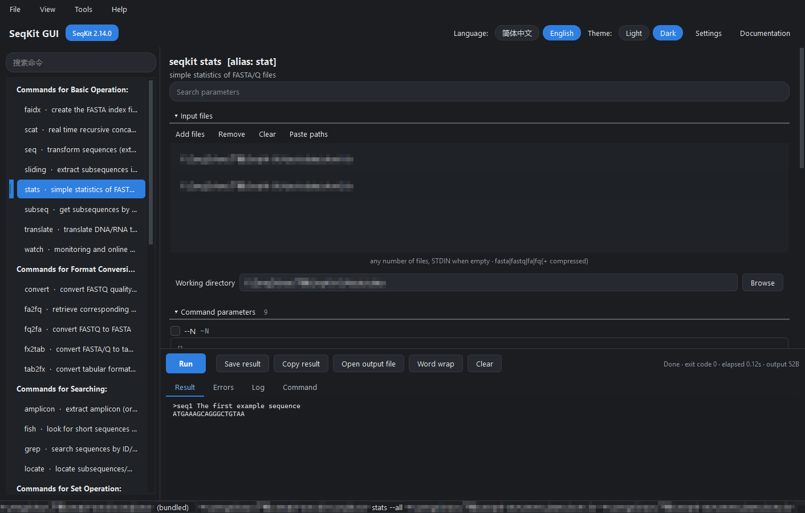
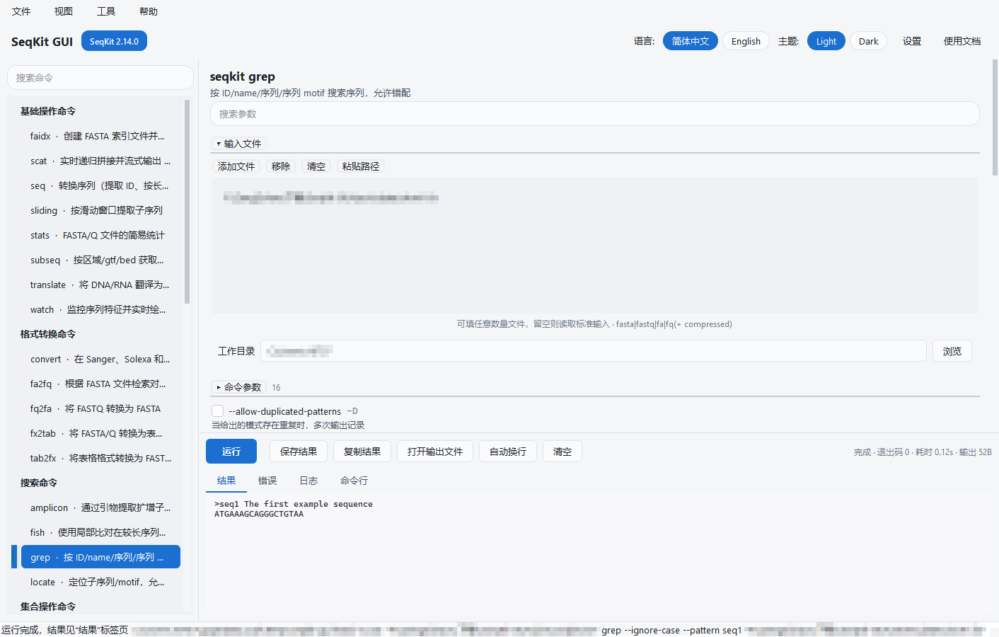
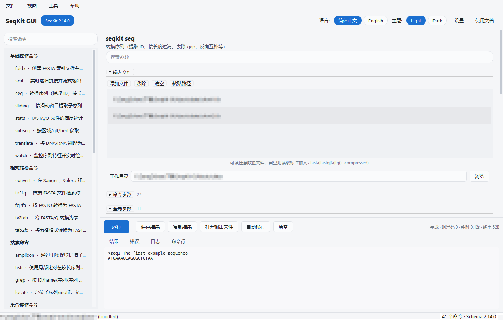
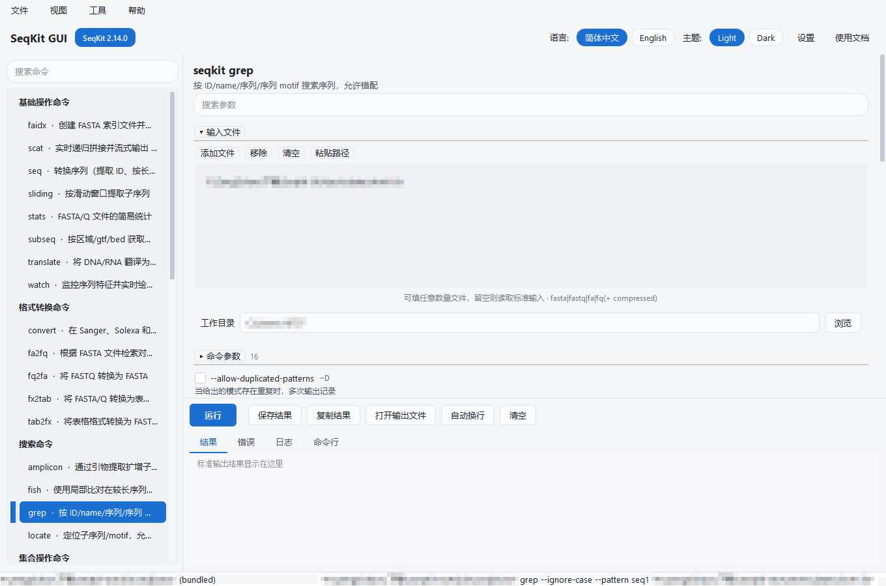

# SeqKit GUI

An **unofficial** desktop graphical interface for [SeqKit](https://github.com/shenwei356/seqkit), written in Python 3.10 + PySide6. Windows (x64) is the current release platform and the only one the interface has been tested on; the code structure keeps a macOS port cheap. See [Known limitations](#known-limitations).

> This project is not affiliated with and not endorsed by the author of SeqKit. The interface performs **no sequence processing of its own**: it collects parameters, assembles an argument vector, runs the official `seqkit` executable, and shows what that process writes to stdout and stderr. Results are therefore identical to using the command line.

中文说明: [README.md](README.md)



> Local absolute paths and user names visible in the screenshots have been redacted.

---

## Contents

- [What it does](#what-it-does)
- [Quick start](#quick-start)
- [Window tour](#window-tour)
- [Parameter model: unchecked means not passed](#parameter-model-unchecked-means-not-passed)
- [Supported commands](#supported-commands)
- [Pre-run validation](#pre-run-validation)
- [Language and theme](#language-and-theme)
- [Known limitations](#known-limitations)
- [Running from source / testing / packaging](#running-from-source--testing--packaging)
- [Where the parameter table comes from](#where-the-parameter-table-comes-from)
- [Project layout](#project-layout)
- [macOS and Linux status](#macos-and-linux-status)
- [Documentation](#documentation)
- [Licence and credits](#licence-and-credits)

## What it does

- Pick input files: file dialog, multi-select, drag & drop onto the window, paste paths, remove or clear individual entries.
- Configure seqkit parameters: every parameter of all 41 subcommands renders as the control its real type calls for, with an English or Chinese description.
- Run commands: the child process runs asynchronously so the interface stays responsive, and it can be stopped at any time.
- Inspect results and errors: Result / Errors / Log / Command tabs, plus exit code, elapsed time and output size. Full stdout goes to a file while the preview stays within a configurable line budget.

## Quick start

Don't want to set up Python? A ready-to-run `SeqKit-GUI.exe` sits at the repository root (a PyInstaller one-file build that bundles the Python and Qt runtimes; double-click it). It is still only the front end -- seqkit itself is prepared per step 3 below before any command can run.

1. Install Python 3.10 or newer.
2. Install dependencies:

   ```bash
   python -m pip install -r requirements.txt
   ```

3. Provide the seqkit executable. The repository deliberately **does not** contain it (the executable is about 28 MB unpacked; the official archive is about 8.6 MB). Choose one:

   ```bash
   python tools/fetch_seqkit.py        # downloads the official 2.14.0 release into bin/
   ```

   - drop `seqkit.exe` into the project's `bin/` folder;
   - leave seqkit on the system `PATH`;
   - or point **Settings → SeqKit executable** at it.

   `tools/fetch_seqkit.py` accepts `--version` (default `2.14.0`; the tag is shape-checked before it is spliced into the download URL, so slashes, `..` and the like are refused), `--sha256 <64 hex digits>` (when given, the archive's sha256 digest is verified as a second check on top of upstream's md5), `--force` (overwrite an existing `bin/` file), `--list` (print the release assets this platform can fetch, then exit) and `--timeout` (per-request network timeout in seconds).

   Lookup order: **configured path → `bin/` beside the app → `PATH`** (on macOS `/opt/homebrew/bin` and `/usr/local/bin` are searched as well). Candidate names are `seqkit.exe`, `seqkit.cmd`, `seqkit.bat` and `seqkit` on Windows, and just `seqkit` elsewhere — `seqkit.cmd`/`seqkit.bat` are listed as candidate names but always rejected by the gate below. Every candidate goes through one and the same gate (`seqkit_gui/core/seqkit_locator.py`): it must be an existing file whose first bytes are an image this machine can actually execute — `MZ` on Windows, `\x7fELF` on Linux, a Mach-O magic on macOS. Script files (`.bat`, `.cmd`, `.com`, `.ps1`, `.vbs`, `.js`, `.lnk`, `.url`) are refused outright on Windows because neither `QProcess` nor `subprocess` can start them as a program; off Windows the file needs the `X_OK` execute bit (`#!` scripts excepted). Any candidate sitting directly in the working directory is rejected — the single exception being the path you picked in Settings — and empty or relative `PATH` entries are skipped; all of that is binary-planting hygiene. Repeated paths are tested once. The left status slot then shows the full path plus the source label `configured` / `bundled` / `path`.

4. Launch:

   ```bash
   python -m seqkit_gui
   ```

   On Windows you can also run `run.bat`.

## Window tour

| Area | Contents |
| --- | --- |
| Header bar | Brand, detected SeqKit version badge, **Version mismatch** warning badge (only when the versions differ), language switch, theme switch, **Settings**, **Documentation** |
| Menu bar | File (Add input files / Run / Recent files / Quit), View (Expand all groups / Collapse all groups / Clear output / Search parameters), Tools (Settings / Copy command line / Locate seqkit executable), Help (Open documentation folder / SeqKit official documentation / About SeqKit GUI). There is no right-click context menu anywhere in the window |
| Command tree (left) | The eight groups seqkit itself declares, plus a final node the interface synthesises (`Other`) holding `version` and `genautocomplete` -- nine top-level nodes, 41 commands; the search box above filters by command name, summary in either language, and aliases |
| Parameter form (right) | Input files, Working directory, Command parameters, Global parameters, Extra arguments, Notes, Documentation (the command's full description and examples) |
| Output panel (bottom) | Result / Errors / Log / Command tabs, plus Run, Stop, Save result, Copy result, Open output file, Word wrap, Clear, and on the far right the summary line `exit code · elapsed · output bytes` |
| Status bar | Left: the seqkit path in use and where it came from, or the outcome of the last run. Right: the exact command line that would run; straight after a lookup it briefly reads `41 commands · Schema 2.14.0` |

Every shortcut: `Ctrl+Enter` and `Ctrl+R` run, `Ctrl+O` add input files, `Ctrl+F` search parameters, `Ctrl+Shift+C` copy command line, `Ctrl+,` settings, `Ctrl+Q` quit.



## Parameter model: unchecked means not passed

This is the only rule about the interface worth learning:

- Every **non-boolean** flag row has an enable checkbox on its left. While unchecked the flag is **not passed at all**, so seqkit applies its own default; ticking it sends the editor's value.
- For a **boolean** flag, the row's checkbox *is* the switch: ticking it appends `--flag`.
- **Repeatable** flags (for example `grep -p/--pattern`) use a multi-line editor, **one value per line**, expanded into `--pattern a --pattern b`.
- **Enumerated** flags are populated from the choices seqkit itself lists in its usage text (for instance `--seq-type` offering `dna|rna|protein|unlimit|auto`); the combo stays editable.
- **File and directory** flags get browse buttons, with separate open and save dialogs.
- For full control, type additional options into **Extra arguments**; they are split into separate arguments without ever involving a shell.

`seq` with its 27 parameters, and the expanded global-parameter section:



## Supported commands

All 41 SeqKit 2.14.0 subcommands are covered, using seqkit's own groups and counts:

| Group | Count | Commands |
| --- | --- | --- |
| Commands for Basic Operation | 8 | `faidx` `scat` `seq` `sliding` `stats` `subseq` `translate` `watch` |
| Commands for Format Conversion | 5 | `convert` `fa2fq` `fq2fa` `fx2tab` `tab2fx` |
| Commands for Searching | 4 | `amplicon` `fish` `grep` `locate` |
| Commands for Set Operation | 11 | `common` `duplicate` `head` `head-genome` `pair` `range` `rmdup` `sample` `sample2` `split` `split2` |
| Commands for Edit | 6 | `concat` `mutate` `rename` `replace` `restart` `sana` |
| Commands for Ordering | 2 | `shuffle` `sort` |
| Commands for BAM Processing | 1 | `bam` |
| Commands for Miscellaneous | 2 | `merge-slides` `sum` |
| Other (synthesised node) | 2 | `genautocomplete` `version` |

Group names and membership are taken straight from seqkit's own command groups, unchanged. `version` and `genautocomplete` carry no cobra group ID upstream (`seqkit --help` lists them under `Additional Commands`), so the interface gives them their own final node, titled `Other` in English and `其他` in Chinese.

Per-command required parameters and worked GUI examples: [docs/en/command-guide.md](docs/en/command-guide.md).

## Pre-run validation

Before launching a process the form checks constraints read out of each command's source. A failing form lists what is missing, turns the description of the offending rows red, and the process **never starts**:

- Required alternatives (`requires_any`): `grep`/`locate` need `--pattern` or `--pattern-file`; `sample`/`sample2` need `--number` or `--proportion`; `split` needs one of `--by-size`/`--by-part`/`--by-id`/`--by-region`; `split2` needs one of `--by-size`/`--by-part`/`--by-length`; `subseq` needs one of `--region`/`--bed`/`--gtf`; `restart` needs `--new-start` or `--start-with`; `amplicon` needs one of `--bed`/`--primer-file`/`--forward`/`--reverse`; `fish` needs `--query-fastx` or `--query-sequences`; `mutate` needs one of `--point`/`--insertion`/`--deletion`/`--pattern`/`--pattern-file`; `replace` needs `--pattern` or `--f-pattern`; `bam` needs one of `--stat`/`--idx-stat`/`--idx-count`/`--count`/`--grep-ids`/`--dump`/`--top-bam`/`--tool`/`--list-fields`.
- Required together (`requires_all`): `sliding` needs `--window` and `--step`; `pair` needs `--read1` and `--read2`; `range` needs `--range`; `fa2fq` needs `--fasta-file`.
- Mutually exclusive (`forbid_pairs`): `seq` `--lower-case`✕`--upper-case` and `--dna2rna`✕`--rna2dna`; `mutate` `--insertion`✕`--deletion`; `locate` `--degenerate`✕`--max-mismatch` and `--use-regexp`✕`--max-mismatch`; `subseq` `--bed`✕`--feature` and `--only-flank`✕`--up-stream`.
- Conditional (`conditional`): `common`/`rmdup` require `--by-seq` once `--only-positive-strand` or `--check-embedded-seqs` is enabled; `replace` requires `--pattern` once `--keep-key` is enabled; `shuffle`/`sort`/`split` require `--two-pass` once `--keep-temp` or `--update-faidx` is enabled.
- Input file counts: `common` and `concat` need at least 2 files; `faidx`, `scat` and `watch` need at least 1; `sample`, `sample2`, `split` and `split2` accept at most 1; `faidx` supports neither stdin nor compressed input; `pair`, `version` and `genautocomplete` reject positional arguments.
- Bounded runs (`BOUNDED_RUN_FLAGS`, `seqkit_gui/core/builder.py:49-51`): `scat` puts an fsnotify watcher on the given directories and loops until it is told how to stop, so the interface requires at least one of `--find-only` (concatenate the existing files and exit) or `--time-limit` (exit after this long with no activity) and otherwise **does not start the process**, reporting `one of --find-only / --time-limit is required`. `--wait-pid` does not count as an exit condition: its default value `-1` disables that timer. This rule is returned by `validate()` alongside the families above, but it is **not shown in the Notes section** -- Notes renders only the `requires_any` / `requires_all` / `conditional` / `forbid_pairs` recorded in the parameter table.

Every rule in the families above comes from the per-command records in the parameter table (`requires_any` / `requires_all` / `forbid_pairs` / `conditional` / `inputs`, each with the seqkit source file and line in `evidence`). The interface invents no rules of its own and does not replace seqkit's own checks; the bounded-run entry is the single rule that lives in code (`BOUNDED_RUN_FLAGS` in `builder.py`), and its basis is upstream's own `scat` implementation.

## Language and theme

- Interface language: 简体中文 / English, switched live from the header bar. UI strings live in `seqkit_gui/i18n/`; Chinese flag and command descriptions are merged into the parameter table from `tools/translations/`. All 353 command-local flags and all 11 global flags carry Chinese descriptions.
- Theme: Light / Dark, with all colour tokens in `seqkit_gui/ui/theme.py`. Filled surfaces always carry white text so contrast holds in both themes.
- Language, theme, seqkit path, preview line limit, default working directory, window geometry and recent files are remembered between runs.



## Known limitations

These statements describe how the code behaves today; they are not a to-do list.

1. **Only Windows has been tested.** Every screenshot and every end-to-end manual check was produced on Windows x64. The macOS and Linux code paths genuinely exist (`executable_names()` in `seqkit_gui/core/paths.py`, the Darwin-only `/opt/homebrew/bin` and `/usr/local/bin` prefixes in `seqkit_gui/core/seqkit_locator.py`, `run.sh`, the `Darwin`/`Linux` branches of `tools/fetch_seqkit.py`) but **nobody has opened this window on a real macOS or Linux machine, looked at how it renders, or run a command through it by hand**, and no packaged build exists for either platform. Linux is in exactly the same position as macOS: code branches, no desktop verification.
2. **No stdin proxying, no pipe mode.** Input has to be file paths: the file list, `--infile-list`, or one of the per-command file flags. The child's write channel is closed with `closeWriteChannel()` the moment it starts (`SeqkitRunner.start()` in `seqkit_gui/core/runner.py`), so seqkit sees a standard input that is immediately at end-of-file. A run with no input files therefore finishes with exit code 0 and nothing to show, and the status bar reports `Finished without writing anything to standard output` rather than the interface hanging. There is no `cat x.fa | SeqKit-GUI`, and the interface never writes anything into the child. The one command that genuinely cannot stop on its own is `scat`, which installs an fsnotify watcher on directories; the interface refuses to start it without an exit condition (see **Pre-run validation**).
3. **The parameter table is pinned to seqkit 2.14.0.** `seqkit_version` in `seqkit_gui/data/commands.json` is `2.14.0`. With a different seqkit: flags added in newer releases simply do not appear, and flags your binary does not know are still listed. That is what the **Version mismatch** badge is for. If seqkit rejects an argument vector the interface assembled, it exits non-zero, its verbatim stderr lands in the **Errors** tab, the status line reads `Failed · exit code N`, and the panel switches to **Errors** automatically -- no retry, no reinterpretation.
4. **`--threads` carries a recorded default, not a machine-derived one.** The `default` field of `--threads` in the parameter table is `4`, which is the literal default seqkit 2.14.0 prints in its own help (`-j, --threads int … (default 4)`; the binary on this 16-core machine reports the same 4). The interface pre-fills that `4` into the spin box and labels it `default: 4`; it never recomputes the value from `os.cpu_count()` or any other local information. Leaving `--threads` unticked sends nothing at all, so the thread count is whatever the seqkit in hand decides. Upstream's actual rule is `min(NumCPU, 4)`, overridden by the `SEQKIT_THREADS` environment variable (`seqkit/cmd/root.go:113-128`) -- which means `4` matches what your seqkit would pick on any machine with four or more cores, and does not on a smaller one.
5. **Some defaults hold a home-directory placeholder.** The table stores `genautocomplete --file` in the neutral form `$HOME/.bash_completion.d/seqkit.sh` (upstream defines that default as a runtime expansion of the home directory, so capturing it verbatim would freeze the generating machine's real path into the table). The interface expands `$HOME` to your own home directory before pre-filling it; confirm the resolved destination is where you want the file written before running that command.
6. **SeqKit is not redistributed.** `bin/` is gitignored and neither the repository nor the packaged build contains a seqkit executable (about 28 MB unpacked). Users supply it themselves: put it in `bin/`, put it on `PATH`, point Settings at it, or run `python tools/fetch_seqkit.py` to fetch it from the official GitHub releases.
7. **Copied text carries traces of your machine.** The **Command** tab, **Tools → Copy command line**, the **Log** tab and the status bar all contain the absolute path of the seqkit executable, the absolute paths of the input and output files, the working directory and the temporary file path -- strings that normally embed your user name (`C:\Users\<you>\…`) and drive letters. Strip those paths before pasting a command or a log into an issue, a chat or a paper attachment.
8. **What the interface displays is bounded.** The Result tab shows the first *N* lines (default 5000, Settings range 500-200000) and each text view keeps at most the most recent 20000 blocks. The complete stdout always goes to `seqkit-gui-*.out` in the system temp directory, and **Save result** / **Open output file** read that full capture; the app never deletes those temp files itself.
9. **Non-UTF-8 output is replaced, not preserved.** stdout and stderr are decoded incrementally as UTF-8 and undecodable bytes become replacement characters on screen. The temp file holds the original bytes, so use **Save result** when you need them unaltered. ANSI colour codes are stripped before display.
10. **One command at a time.** `SeqkitRunner` owns a single `QProcess`; a second run request while it is busy is ignored and the form and its input fields are locked. Start extra program instances if you need parallelism.
11. **English UI text uses the key-as-English strategy.** The two catalogues are not the same size: `seqkit_gui/i18n/zh_CN.json` is markedly larger than `en_US.json`, which only catalogues part of the strings (the exact key counts are whatever the files currently hold). Every key the code actually looks up has a Chinese entry, so Chinese mode never falls back to English text. In English mode a key that is not catalogued renders as the key itself (which is English source text), and some labels therefore keep the source casing rather than being separately polished: when seqkit is missing, the header badge and the title of the run dialog read `seqkit not found` in English mode and `未找到 seqkit` in Chinese mode.
12. **The parameter filter matches English only.** The form's filter searches the long flag name, the shorthand and the **English** usage text; in Chinese mode a Chinese-language needle finds nothing, so search by `--name` or `-x`.
13. **Soft seqkit-side constraints are not validated.** For example `bam` accepting only one file outside `--stat`/`--idx-stat`, `merge-slides` refusing an output that is also an input, `shuffle`/`sort` accepting only one file under `--two-pass`: these appear in the **Notes** section as guidance, but pre-run validation covers only the hard rule families listed above and leaves the rest for seqkit to report.
14. **There is no right-click context menu.** The only menus are File / View / Tools / Help in the menu bar; the file list is driven by its tool buttons and drag & drop.
15. **No network access, no self-updates.** The application performs no network calls and never checks for a newer version of itself. The only thing that can reach the network is seqkit's own `version --check-update` flag if you deliberately tick it -- that is upstream behaviour, not this interface's.

## Running from source / testing / packaging

```bash
python -m pip install -r requirements.txt
python -m seqkit_gui                      # run from source

python -m pytest tests -q                 # run the whole suite; the case count changes with the code, so trust this command's own output

pip install pyinstaller
pyinstaller packaging/seqkit_gui.spec     # -> dist/SeqKit-GUI/
```

The tests use a real seqkit executable: they cross-check the command list, each command's `--help` and every flag name against the CLI, and run several end-to-end invocations, so `bin/seqkit.exe` must exist before running them.

The build is **onedir** (a folder, not a single executable): the program is `dist/SeqKit-GUI/SeqKit-GUI.exe`, and the parameter table, interface catalogues and icons sit under `dist/SeqKit-GUI/_internal/seqkit_gui/{data,i18n,assets}`. A release zips that folder into `SeqKit-GUI-<version>-windows-x64.zip` (`<version>` comes from `__version__` in `seqkit_gui/__init__.py`, currently `1.0.0`) and ships a sibling digest file `SeqKit-GUI-<version>-windows-x64.zip.sha256` holding the one line `sha256sum -c` can verify. The archive **does not contain `seqkit.exe`** -- `packaging/seqkit_gui.spec` inspects every collected file and aborts the build if any of them comes from the repository's `bin/`. After unpacking, place `seqkit.exe` in the `bin/` folder beside the program yourself: `dist/SeqKit-GUI/bin/seqkit.exe`, which is exactly the second location the app searches.

## Where the parameter table comes from

No parameter in the interface is hand-written; the table is generated from SeqKit 2.14.0 source:

1. `tools/spec-dumper` (Go) imports seqkit's `cmd` package, walks the cobra command tree and exports every command with its pflag-registered name, shorthand, type, default and verbatim usage text.
2. `tools/extract_spec.py` normalises that into `seqkit_gui/data/commands.json`: it decides which control each parameter needs, extracts enumerated choices, merges Chinese descriptions, and attaches the input-file contract and required-parameter constraints read from each command's `Run` body (recording the source file and line).

Regenerate with:

```bash
python tools/extract_spec.py --build --seqkit-src ../../../seqkit-2.14.0
```

That step needs the Go toolchain; using the app and running the tests does not.

## Project layout

```
seqkit_gui/
  core/       interface-free parts: schema, argument building, subprocess,
              executable lookup, persisted settings
  ui/         PySide6 interface: main window, dynamic form, output panel, theme, language
  data/       commands.json -- the generated command and parameter table
  i18n/       interface text catalogues
  assets/     icons
tools/
  spec-dumper/  Go tool exporting the cobra command tree
  extract_spec.py  builds data/commands.json
  fetch_seqkit.py  downloads the official seqkit release
  translations/    Chinese flag and command descriptions
tests/        schema fidelity, argument building, validation, real runs, window construction
docs/         bilingual documentation and screenshots
packaging/    PyInstaller configuration
```

## macOS and Linux status

Platform differences are isolated, so the interface code does not change:

- `seqkit_gui/core/paths.py` decides the candidate executable names (`seqkit.exe`, `seqkit.cmd`, `seqkit.bat`, `seqkit` on Windows; only `seqkit` elsewhere), the `bin/` location and the resource folders.
- `seqkit_gui/core/seqkit_locator.py` adds `/opt/homebrew/bin` and `/usr/local/bin` on Darwin; the executable-image magic the gate checks is switched per platform (`\x7fELF`/`MZ` on Linux, the Mach-O variants on macOS), non-Windows platforms additionally require the `X_OK` bit and accept `#!` scripts, and the `.bat`/`.cmd` suffix blacklist is only in force on Windows.
- The child process is started from an argument list, with no platform-specific API and no shell; the displayed command line picks the quoting style the current platform's shell expects.
- `run.sh` and `tools/fetch_seqkit.py` are already written for POSIX. The downloader knows `Windows`, `Darwin` and `Linux` (architectures `amd64`/`x86_64` and `arm64`/`aarch64`). Upstream also publishes `freebsd` and `openbsd` builds, which the downloader does not know -- place those in `bin/` by hand.
- None of those code paths has been opened and driven by hand on a real macOS or Linux desktop (see [Known limitations](#known-limitations), item 1).

## Documentation

- English: [Getting started](docs/en/getting-started.md) · [Interface guide](docs/en/interface-guide.md) · [Command guide](docs/en/command-guide.md) · [User guide](docs/en/user-guide.md) · [FAQ](docs/en/faq.md) · [Development](docs/en/development.md)
- 中文: [入门](docs/zh/getting-started.md) · [界面说明](docs/zh/interface-guide.md) · [命令指南](docs/zh/command-guide.md) · [使用手册](docs/zh/user-guide.md) · [常见问题](docs/zh/faq.md) · [开发指南](docs/zh/development.md)
- Contributing: [CONTRIBUTING.en.md](CONTRIBUTING.en.md) (English) · [CONTRIBUTING.md](CONTRIBUTING.md)（中文）; the issue and pull-request forms are under `.github/ISSUE_TEMPLATE/` and `.github/pull_request_template.md`
- Where to ask for help: [SUPPORT.md](SUPPORT.md); to report a vulnerability follow [SECURITY.md](SECURITY.md); community behaviour is covered by [CODE_OF_CONDUCT.md](CODE_OF_CONDUCT.md)
- For what any parameter means, the upstream documentation is authoritative: <https://bioinf.shenwei.me/seqkit/>

## Licence and credits

- This project is released under the **MIT** licence, see [LICENSE](LICENSE).
- [SeqKit](https://github.com/shenwei356/seqkit) is the upstream project led by Wei Shen (`shenwei356`) and is likewise MIT licensed; its copyright notice and full licence text are preserved in [THIRD-PARTY-LICENSES.md](THIRD-PARTY-LICENSES.md). This repository does not redistribute the SeqKit program and has no endorsement from upstream.
- The interface is built with PySide6 (Qt for Python, LGPLv3); the attribution requirements are noted in [THIRD-PARTY-LICENSES.md](THIRD-PARTY-LICENSES.md).
- The citation upstream itself asks for (`seqkit --help` and the SeqKit README; SeqKit 2.14.0 belongs to the SeqKit2 paper):

  > Wei Shen\*, Botond Sipos, and Liuyang Zhao. 2024. *SeqKit2: A Swiss Army Knife for Sequence and Alignment Processing.* **iMeta** e191. <https://doi.org/10.1002/imt2.191>

**This is an unofficial project. It is not affiliated with the author of SeqKit and is not the official SeqKit graphical interface.**
