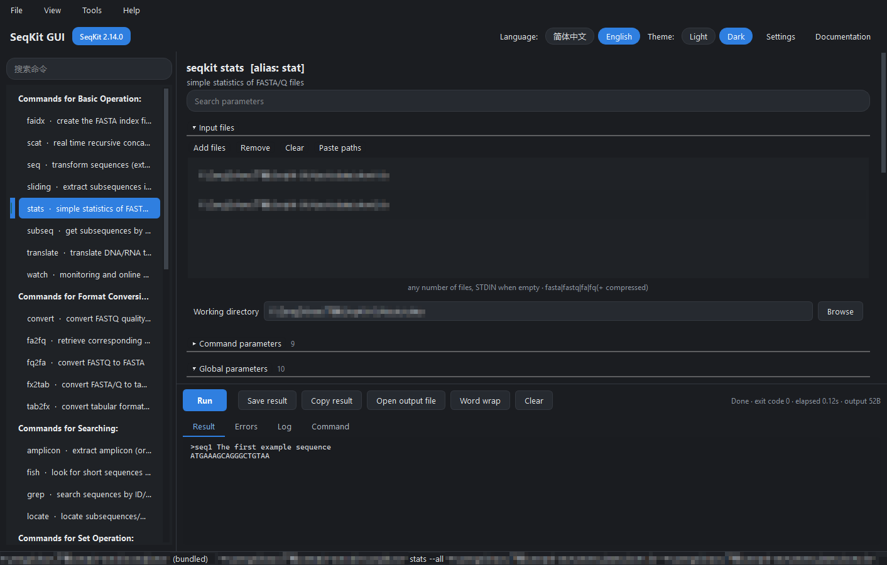

# 界面逐区说明

> 本文是**非官方 SeqKit GUI** 的简体中文文档，逐区介绍窗口每个部分的作用与可点的地方。SeqKit GUI 是 [SeqKit](https://github.com/shenwei356/seqkit)（Wei Shen 开发的 MIT 许可序列工具包）的桌面图形前端；本项目与 SeqKit 项目无关，未获其认可，也不由其维护，不是 SeqKit 的官方图形界面。

## 0. 布局总览

```text
┌──────────────────────────────────────────────────────────────────────────┐
│ 菜单栏：文件  视图  工具  帮助                                             │
├──────────────────────────────────────────────────────────────────────────┤
│ SeqKit GUI  [SeqKit 2.14.0]        语言: [简体中文|English] 主题: [Light|Dark]  设置  使用文档 │
├───────────────┬──────────────────────────────────────────────────────────┤
│ 搜索命令       │  seqkit grep                                            │
│ ┌───────────┐ │  按 ID/name/序列/序列 motif 搜索序列，允许错配              │
│ │ 基础操作命令│ │  ┌ 搜索参数 ─────────────────────────────────────────┐   │
│ │  faidx    │ │  ▾ 输入文件   添加文件 移除 清空 粘贴路径               │   │
│ │  scat     │ │    工作目录  [____________________] 浏览                │   │
│ │  ...      │ │  ▾ 命令参数  16                                        │   │
│ │ 搜索命令   │ │  ▸ 全局参数  11                                        │   │
│ │  ...      │ │  ▸ 附加参数   ▾ 注意事项   ▸ 文档                       │   │
│ └───────────┘ ├──────────────────────────────────────────────────────────┤
│   （左侧）     │ 运行 停止 保存结果 复制结果 打开输出文件 自动换行 清空  状态 │
│               │ [结果] [错误] [日志] [命令行]                              │
│               │   （右下：输出面板）                                       │
├───────────────┴──────────────────────────────────────────────────────────┤
│ 状态栏左：seqkit 路径 / 运行提示          状态栏右：命令行实时预览           │
└──────────────────────────────────────────────────────────────────────────┘
```

窗口初始尺寸 1320×860，左右分栏默认 280 / 1040，右侧上下分栏按 3:2 分配；窗口大小位置与左右分栏比例会在关闭时记住、下次启动恢复。


本文引用的截图取自真实窗口，其中的本机路径与用户名以打码/替换后的形式呈现；如需不含打码的干净原图，要先在一个净化过的示例目录（不含真实用户名与项目路径）里重新截取。

## 1. 顶栏

| 元素 | 作用 |
| --- | --- |
| `SeqKit GUI` | 品牌文字（窗口标题同名） |
| `SeqKit 2.14.0` 徽标 | 检测到的 seqkit 版本；鼠标悬停显示所用可执行文件的完整路径。找不到时显示“未找到 seqkit” |
| “版本不匹配”徽标 | 仅当检测到的版本与参数表版本（2.14.0）不一致时出现，悬停说明“参数可能不完全一致” |
| 语言：简体中文 / English | 即时切换界面文字与参数说明，无需重启 |
| 主题：Light / Dark | 即时切换浅色/深色配色 |
| **设置** | 打开设置对话框（等同 `Ctrl+,`） |
| **使用文档** | 用系统默认方式打开文档目录 `docs/` |

## 2. 菜单栏

| 菜单 | 项目 | 快捷键 | 说明 |
| --- | --- | --- | --- |
| 文件 | 添加输入文件 | `Ctrl+O` | 多选文件后追加到当前命令的输入文件列表 |
| 文件 | 运行 | `Ctrl+R` | 校验并开始执行；窗口内也可用 `Ctrl+Enter`（代码中注册为 `Ctrl+Return`） |
| 文件 | 最近使用的文件 | — | 子菜单列出用过的输入文件，点击即加入列表；底部有**清除列表** |
| 文件 | 退出 | `Ctrl+Q` | 关闭窗口 |
| 视图 | 展开全部命令分组 / 折叠全部命令分组 | — | 控制左侧命令树 |
| 视图 | 清空输出 | — | 清空输出面板四个标签与状态文字 |
| 视图 | 搜索命令 | `Ctrl+L` | 焦点跳到左侧“搜索命令”框并全选其中文字 |
| 视图 | 搜索参数 | `Ctrl+F` | 焦点跳到参数表单的“搜索参数”框 |
| 工具 | 设置 | `Ctrl+,` | 打开设置对话框 |
| 工具 | 复制完整命令 | `Ctrl+Shift+C` | 复制“命令行”标签里的内容到剪贴板 |
| 工具 | 手动指定 seqkit 可执行文件 | — | 用文件对话框选一个可执行文件并写入设置，随后立即重新检测 |
| 帮助 | 打开文档目录 | — | 同顶栏**使用文档** |
| 帮助 | SeqKit 官方文档 | — | 用浏览器打开 <https://bioinf.shenwei.me/seqkit/> |
| 帮助 | 关于 SeqKit GUI | — | 打开关于对话框 |

## 3. 左侧：命令树

- **搜索命令**框按 命令名 / 中文摘要 / 英文摘要 / 别名 做子串匹配，命中的分组自动展开；把鼠标移到搜索框上会显示“匹配到 N 个命令”。清空即恢复全树。
- 命令按 SeqKit 自身的 8 个分组呈现：基础操作命令、格式转换命令、搜索命令、集合操作命令、编辑命令、排序命令、BAM 处理命令、杂项命令；分组标题加粗且不可选中。`version` 与 `genautocomplete` 在 seqkit 的 cobra 定义里没有分组 ID，界面为它们合成一个末尾节点，中文标题 `其他`、英文标题 `Other`（`seqkit_gui/core/spec.py` 的 `in_groups()`），因此命令树共 9 个顶层节点。
- 每个条目显示 `命令名 · 中文摘要`，悬停提示为 `seqkit 命令名` 加英文说明。
- 选中一条命令即用它重建右侧表单。运行期间选单不会被拦下，切换命令只会重建表单，正在跑的那条进程不受影响。

## 4. 右侧上方：参数表单

标题区显示 `seqkit 命令名`（有别名时附 `[alias: stat]`）、一句话摘要，以及**搜索参数**框——输入关键词只影响显示，例如输入 `reverse` 后仅剩名字/短选项/说明里含该词的行，不会丢失已填的值。

表单从上到下由若干可折叠分区组成（点标题行折叠/展开）：

| 分区 | 默认状态 | 内容 |
| --- | --- | --- |
| 输入文件 | 展开 | 文件列表 + **添加文件 / 移除 / 清空 / 粘贴路径** 四个按钮 + 工作目录一行 |
| 命令参数 | 展开 | 该命令的专属参数行，标题右侧数字为参数个数（如 `grep` 为 16，`seq` 为 27） |
| 全局参数 | 折叠 | seqkit 的 11 个全局参数行（`stats` 为 10 个，它的 `-S/--skip-file-check` 属于命令专属参数） |
| 附加参数 | 折叠 | 一个自由文本框，按 shell 规则切分后追加在所有参数选项之后、位置输入文件之前 |
| 注意事项 | 有内容才显示 | 该命令的运行前约束与来自 seqkit 源码的中文提示 |
| 文档 | 折叠 | seqkit 自己的长说明文本（英文），可选中复制 |

### 4.1 输入文件区

- 添加文件用的是多选对话框，过滤器为“序列文件（`*.fa *.fasta *.fq *.fastq *.gz *.bgzip *.bz2 *.xz *.zst *.sam *.bam`）”与“所有文件”。
- 可以直接把资源管理器里的文件/文件夹拖到窗口任意位置加入列表；**粘贴路径**则把剪贴板文本按行导入。列表内路径自动去重。
- **双击**列表里的一条路径可在弹出的对话框中就地修改；改后的文本走与添加相同的清洗与去重规则，改成已有条目则不生效。
- 列表下方的灰色提示语由命令决定，各段之间用 ` · ` 连接，例如：
  - `可填任意数量文件 · 留空时 seqkit 会读取一个立即结束的标准输入，界面不会代你输入内容`
  - `至少 2 个文件`（`common`、`concat`）、`至少 1 个文件`（`faidx`、`scat`、`watch`）
  - `最多 1 个文件`（`sample`、`sample2`、`split`、`split2`）
  - `文件夹会被递归读取`（`scat`，它的位置参数是路径而非文件）
  - `该命令不需要输入文件`（`version`、`genautocomplete`、`pair`）
  - `该命令不支持从标准输入读取 · 不支持压缩文件`（`faidx`）
  - 末尾还会附上参数表里记录的可接受格式串 `fasta|fastq|fa|fq(+ compressed)`（BAM 命令是 `bam|sam`），这一段始终是英文
- 对只接受一个文件的命令，列表的选择模式变为单选（只影响选中行为，数量限制由运行前校验负责）。
- **工作目录**一行决定 seqkit 子进程的当前目录（影响相对路径与 `split` 等命令生成的目录），留空时使用用户主目录；点**浏览**选文件夹。

### 4.2 参数行的结构（本 GUI 的核心）

```text
[ ] --pattern      -p   [必填]
    ┌──────────────────────────────────────────────────────────┐
    │ 多行/单行/数字/下拉/文件 编辑器（未勾选时禁用）              │
    └──────────────────────────────────────────────────────────┘
    搜索模式。支持多个值：以逗号分隔……（中文说明，缺失时显示英文）
```

| 位置 | 含义 |
| --- | --- |
| 勾选框 + `--长名` | **是否把该参数传给 seqkit**。不勾选 → 命令行里完全不出现该参数，seqkit 使用自己的默认值 |
| 灰色 `-p` | 该参数的短选项，仅作提示；实际传给 seqkit 的一律是 `--长名` 形式 |
| “必填”红标 | 该参数属于本命令的运行前必需项（必需或“多选一”都会标注） |
| 编辑器 | 由参数类型决定，见下表；未勾选时置灰不可用 |
| 右上“默认值: …” | seqkit 自己的默认值，供参考；不勾选即可沿用。整数框与文本框会显示这一行，多行框、下拉框和文件框不显示（`grep --pattern` 这类可重复参数的行右侧就是空白） |
| 说明文字 | 中文译名优先，无译文时回退英文原文；校验失败时整行说明变红 |
| 悬停提示 | `-p, --pattern` / `type: stringSlice` / `default: []` / 英文 usage（这四行始终是英文，`default:` 在默认值为空时显示 `(empty)`） |

编辑器类型与参数模型的对应关系：

| 界面控件 | 对应参数 | 提交方式 |
| --- | --- | --- |
| 仅勾选框，无编辑器 | 布尔开关（`--by-seq`、`--all`、`--quiet` 等，命令专属参数里有 184 个） | 勾选 → 只传 `--flag`；不勾选 → 不传 |
| 单行文本框 | 字符串（`--region`、`--replacement` 等） | `--flag 值` |
| 整数框 / 小数框 | `int` / `float`（`--window`、`--min-qual` 等） | 以文本形式传值 |
| 可编辑下拉框 | seqkit 在 usage 括号里枚举了取值（`--seq-type` 的 `dna|rna|protein|unlimit|auto`、`genautocomplete --shell` 的 `bash|zsh|fish|powershell`） | 下拉选值，也可手动输入其他值 |
| 多行文本框 | 可重复参数（`stringSlice`，如 `grep -p`、`mutate -p`、`translate -f`） | **每行一个值**，展开成重复的 `--pattern a --pattern b` |
| 文本框 + **浏览** | 输入文件类（`--pattern-file`、`--read1`、`subseq --bed` 等）/ 输出文件类（`--out-file`、`--dup-seqs-file`、`--img` 等）/ 目录类（`--out-dir`、`--tmp-dir`） | 打开对应文件对话框回填路径 |

两个容易踩到的细节：

- 值本身以 `-` 开头时（例如 `--compress-level -1`、`--frame -1`、`--point -1:A`），界面会自动写成 `--flag=-1` 形式，避免被 seqkit 误认为选项。
- 多行框只出现在 seqkit 声明为 `stringSlice` 的参数上（`grep -p/--pattern`、`fx2tab -C/--base-count`、`translate -f/--frame`、`stats -N/--N`、`subseq --chr/--feature`、`tab2fx -p/--comment-line-prefix` 等，全部参数表里共 14 个命令专属的可重复参数）。这类参数的短选项并不统一：`grep`/`locate` 的 `--pattern` 是 `-p`，`mutate` 的 `--pattern` 却是 `-s` 而 `--point` 是 `-p`，`replace`/`seq` 的 `--f-pattern`、`subseq` 的 `--chr`/`--feature` 根本没有短选项。行上显示的灰色短选项就是 seqkit 自己声明的那一个。

### 4.3 注意事项区

内容来自参数表里记录的 seqkit 源码约束，逐行列出，每行都是界面按当前语言渲染出来的句子。`grep` 在中文界面下是：
```text
必须设置其中之一：--pattern / --pattern-file
```

英文界面下同一行是 `one of --pattern / --pattern-file is required`。`seq` 列出互斥对 `--lower-case 与 --upper-case 不能同时使用`；`common` 列出条件对 `启用 --only-positive-strand 时必须同时设置 --by-seq`；`range` 列出 `--range 为必填项`。此外还有来自 seqkit 源码的中文补充说明（如 `faidx` 的“不支持 stdin，也不支持 gz/xz/zst 压缩文件”）。没有任何约束的命令不显示该分区，分区标题右侧的数字是行数。

注意事项渲染的是参数表里的四类约束（`seqkit_gui/ui/param_form.py` 的 `_build_notes()` 只读 `requires_any` / `requires_all` / `conditional` / `forbid_pairs`）。`scat` 的有界运行规则不在其中：它由 `core/builder.py` 的 `BOUNDED_RUN_FLAGS` 在 `validate()` 阶段追加，所以选中 `scat` 时注意事项里看不到它，但点**运行**会弹窗 `必须设置其中之一：--find-only / --time-limit` 并且不创建子进程。`scat` 之所以需要这条规则，是上游实现决定的：它对给定目录建立 fsnotify 监听器并循环，不给退出条件就永不返回。

### 4.4 表单语义

这四条就是界面与 seqkit 之间的全部约定，实现都在 `seqkit_gui/core/builder.py`：

1. **不勾选就完全不传。** 编辑器里预填的是 seqkit 自己的默认值，仅作提示，不会进入命令行，所以 seqkit 用它内置的默认值。这就是表单可以在一个参数都没填的情况下直接开始。
2. **布尔行的勾选框就是开关本身。** 勾选 → 追加 `--lower-case`；不勾选 → 命令行里没有这一项。
3. **可重复参数一行一个值。** `stringSlice` 类型的行（如 `grep -p`）展开为 `--pattern a --pattern b --pattern c`，空行丢弃。
4. **下拉框保持可编辑。** `--seq-type` 的候选 `dna|rna|protein|unlimit|auto` 取自 seqkit 自己的 usage 文本，但你手输的值照样能提交。

两个补充行为：

- 值以 `-` 开头时（例如 `range -r -12:-1`、`mutate -p -1:A`）按 `--flag=值` 传出，避免被 seqkit 读成另一个选项。
- **附加参数**框按 shell 规则切分（`shlex.split(..., posix=False)`），追加在所有参数选项之后、位置输入文件之前；它不经过任何解释器执行，所以 `--by-seq`、`--seq-type dna` 会作为独立 token 到达 seqkit。

### 4.5 参数过滤器

表单顶部的“搜索参数”框隐藏掉名字、短选项与**英文** usage 里不含关键词的行，在 `seq`（27 个参数）或 `bam`（29 个）这类命令上很有用。匹配不区分大小写，但被搜索的说明文本只有英文，所以中文界面下输中文关键词搜不到，请用 `--name` 或 `-x`。`Ctrl+F` 聚焦该框。隐藏行只是不显示，已填的值仍然保留在请求里。

### 4.6 运行前校验

启动子进程前，表单会按参数表里逐命令记录的 seqkit 源码约束做检查：`requires_any`、`requires_all`、`conditional`、`forbid_pairs`、输入文件数量契约，外加 `scat` 的有界运行规则。不通过时弹窗逐条列出问题（文案经界面文案表渲染，中文界面下是中文）、把涉及的参数行标红，并且**不创建子进程**。每条命令的具体必需项见 [命令指南](command-guide.md)。

## 5. 右侧下方：输出面板

按钮从左到右：**运行**、**停止**（仅运行时出现）、**保存结果**、**复制结果**、**打开输出文件**、**自动换行**、**清空**；最右侧是本次运行的状态文字。

| 标签 | 内容 |
| --- | --- |
| 结果 | seqkit 的标准输出，实时滚动 |
| 错误 | seqkit 的标准错误（进度条、警告、报错都在这里），ANSI 颜色码已剥离 |
| 日志 | 合并视图：先记录 `$ 完整命令行` 与 `cd 工作目录`，随后追加 stderr，最后写一行 `[完成] exit=0 elapsed=0.16s bytes=52` |
| 命令行 | 本次实际执行的命令（按当前平台的引号规则转义，可直接复制到终端）；位置输入文件始终排在独立的 `--` 终止符之后，附加参数在终止符之前 |

要点：

- 每次点**运行**都会清空前三个标签，并自动切到**结果**。
- 状态文字形如 `完成 · 退出码 0 · 耗时 0.16s · 输出 52B`；失败时首词变为 `失败` / `已取消` / `启动失败`；退出码非 0 且不是手动取消时自动跳到**错误**标签。启动失败时“错误”与“日志”标签会各补一行本地化的排查提示（检查路径、是否被杀毒软件拦截等）。
- **stdout 会完整落盘到一个临时文件**，界面只显示前 N 行（默认 5000，可在设置里调整，范围 500–200000，执行层还会把下限夹到 200）。超出时结果末尾追加一行“输出预览已截断，完整结果保存在输出文件中”，此时用**打开输出文件**或**保存结果**取全量数据；状态行里的字节数指整次运行，不是预览。每个视图另外只保留最近的 20000 个文本块。
- **保存结果**把这份临时文件原样另存（默认建议文件名 `~/seqkit-result.txt`）；**复制结果**在界面为空时同样回读临时文件，因此截断不影响取全量数据。
- **停止**先发终止信号，4 秒后仍未退出则强制结束进程；`watch` 这类按间隔轮询的命令会一直输出，需要手动停止。`scat` 不同：它靠 fsnotify 监听目录变化、没有退出条件就永不返回，所以界面在**校验阶段**就要求勾选 `--find-only` 或 `--time-limit`，进程根本不会被创建（见 4.3）。
- 运行期间表单与按钮会锁定，状态显示“运行中”。




## 6. 状态栏

| 位置 | 平时 | 运行后 |
| --- | --- | --- |
| 左 | `<seqkit 路径>  (bundled/configured/path)`；找不到 seqkit 时显示获取指引 | 成功且有输出：`运行完成，结果见“结果”标签页 <临时文件路径>`；成功但无输出：`运行成功，但没有标准输出内容` |
| 右 | 当前表单组装出的命令行，随勾选/输入实时变化（过长被截断时悬停可看完整内容）；刷新检测后短暂显示 `41 个命令 · Schema 2.14.0` | 同左 |

## 7. 设置对话框

| 字段 | 说明 |
| --- | --- |
| SeqKit 可执行文件 | 完整路径；留空则走自动检测。右侧**自动检测**按空配置调用定位器，即从 `bin\` 开始、再到 `PATH`（macOS 追加 `/opt/homebrew/bin`、`/usr/local/bin`）重新查找，**浏览**用文件对话框选择 |
| 版本行 + **测试** | 运行 `seqkit version` 验证该文件可用，结果显示版本字符串、`无法运行该文件` 或 `未找到 seqkit` |
| 语言 | 简体中文 / English，即时生效 |
| 主题 | Light / Dark，即时生效 |
| 输出预览行数上限 | 500–200000，步长 500，默认 5000；只影响界面显示，不影响落盘的完整输出 |
| 默认工作目录 | 新选命令时填入“工作目录”的初值；留空时取首个输入文件所在目录，没有输入文件时用用户主目录 |

点**确定**才会保存并生效；取消不会改动现有设置。

## 8. 关于对话框

显示程序版本、非官方声明、SeqKit 归属与许可说明、检测到的 seqkit 版本、参数表统计（`参数表: 2.14.0 · 41 个命令 · 353 个参数 · 11 个全局参数`），以及“本项目 MIT 许可，第三方许可证见 `THIRD-PARTY-LICENSES.md`”。

## 9. 语言与主题的存储

偏好通过 Qt 的 `QSettings` 持久化（组织 `seqkit-gui`，应用 `SeqKit GUI`）。Windows 上落在注册表 `HKEY_CURRENT_USER\Software\seqkit-gui\SeqKit GUI`，主要键：

| 键 | 含义 |
| --- | --- |
| `general/seqkit_path` | 设置的 seqkit 路径 |
| `general/language` / `general/theme` | 语言、主题 |
| `general/working_dir` | 默认工作目录 |
| `ui/output_line_limit` | 输出预览行数上限 |
| `ui/geometry` / `ui/splitter` | 窗口尺寸位置、左右分栏 |
| `files/recent` | 最近使用的文件（保存与显示均不超过 15 条） |

界面文字表位于 `seqkit_gui/i18n/zh_CN.json`（键即英文原文，缺译时回退英文），参数与命令的中文说明来自 `tools/translations/`，详见 [开发说明](development.md)。

## 10. 小技巧

| 想做的事 | 怎么做 |
| --- | --- |
| 只跑一次、想复现到终端 | `Ctrl+Shift+C` 复制命令行，或看状态栏右侧的实时预览 |
| 参数太多找不到 | `Ctrl+F` 聚焦“搜索参数”，输入关键词过滤参数行 |
| 命令找不到 | 左侧“搜索命令”框输入关键词（支持中文、别名如 `stat`、`dup`、`concate`、`rotate`） |
| 界面显示不全 | 拖动左右分栏与右下分栏；或折叠“输入文件”“文档”等分区 |
| 输出很大 | 调高设置里的行数上限，或直接**打开输出文件** |
| 换机器 | 只需拷走项目目录 + `bin\seqkit.exe`；设置存在注册表里，不随目录走 |

## 相关文档

- [安装与第一次运行](getting-started.md)
- [详细使用手册](user-guide.md)
- [命令与参数指南](command-guide.md)
- [常见问题与故障排查](faq.md)
- [从源码运行与二次开发](development.md)

英文文档见 `docs/en/`。
